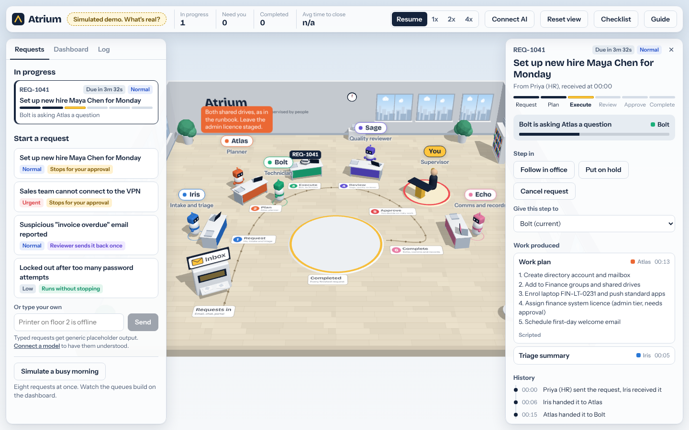
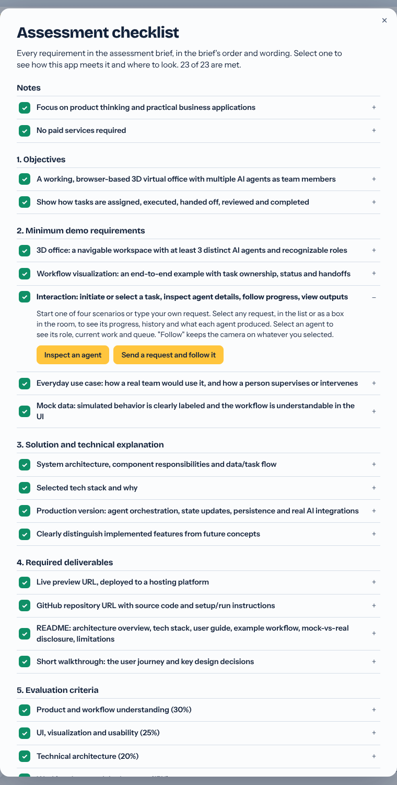
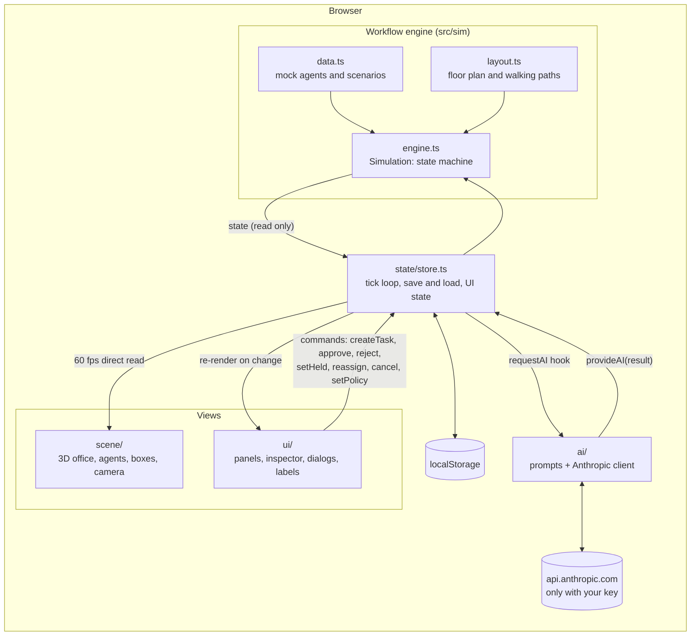
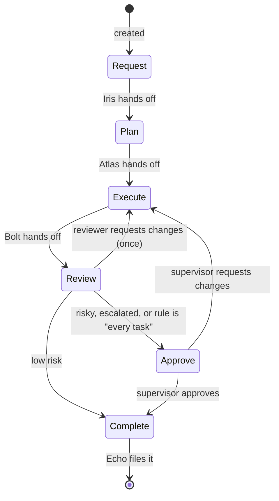
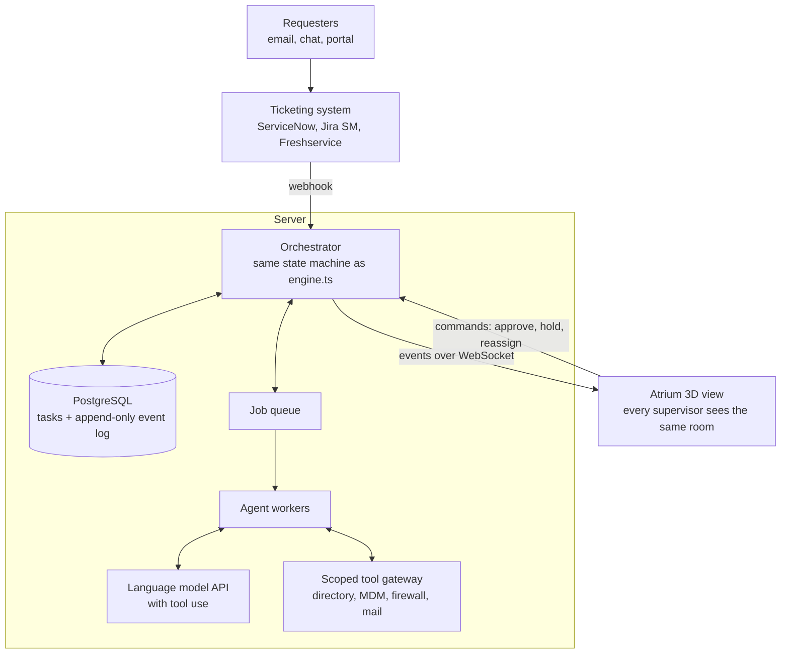

# Atrium: an AI virtual office for the IT service desk

A browser-based 3D office where five AI agents work an IT support queue as a team, and a human supervisor approves risky work and steps in when needed. You can watch each request get triaged, planned, executed, reviewed, approved and closed, and see exactly who owns it at every moment.

| | |
|---|---|
| **Live demo** | https://bgrandy.github.io/virtual-office/ |
| **Repository** | https://github.com/BGrandy/virtual-office |
| **Status** | Working demo. Agents are scripted by default, with an optional live mode where a real Claude model does each step using your own API key. No real IT system is touched in either mode. See [What is real](#what-is-real-simulated-and-proposed). |


**Highlights**

- **Watch the work move.** Each request is a box carried from desk to desk, so you always see who owns it, where work is piling up and what is waiting on you. A two-minute guided tour shows one request from arrival to closed.
- **Human in charge.** Risky work stops for your approval, and you can send back, hold, reassign or cancel anything.
- **Built for a real team.** Response-time targets, a manager dashboard that names the bottleneck, an editable estimate of hours saved, and a full audit export.
- **Optional live AI.** With your own Claude API key, a real model does each agent's step, under a hard spending cap. The workflow engine, not the model, decides what happens next.

## Contents

1. [The problem and the idea](#the-problem-and-the-idea)
2. [How a real team would use it](#how-a-real-team-would-use-it)
3. [User guide](#user-guide)
4. [Example walkthrough](#example-walkthrough)
5. [The dashboard](#the-dashboard)
6. [Live AI mode](#live-ai-mode)
7. [What is real, simulated and proposed](#what-is-real-simulated-and-proposed)
8. [Architecture](#architecture)
9. [Tech stack and why](#tech-stack-and-why)
10. [How this becomes a production system](#how-this-becomes-a-production-system)
11. [Key design decisions](#key-design-decisions)
12. [Run, test and deploy](#run-test-and-deploy)
13. [How the result was verified](#how-the-result-was-verified)
14. [Limitations](#limitations)
15. [How AI tools were used](#how-ai-tools-were-used)

## The problem and the idea

When several AI agents work together, the usual view is a chat transcript or a log. That makes three questions hard to answer quickly:

- **Who has this task right now?**
- **Where is work piling up?**
- **What is waiting on a person?**

Atrium answers them spatially. Each agent has a desk. A request is a physical box. Whoever is holding the box owns the task. A handoff is an agent walking the box to the next desk. A request that needs a human sits glowing on the supervisor's console until someone decides. A manager can glance at the room and read the state of the team without opening a single ticket.

I chose an IT service desk as the setting because it is the work this role does, and because support tickets already follow the pipeline the brief asks for: request, planning, execution, review, completion.

### The team

| Step | Owner | Role | What it does | Guardrail |
|---|---|---|---|---|
| 1. Request | **Iris** | Intake and triage | Classifies the request, sets priority, checks for duplicates | Cannot change any system |
| 2. Plan | **Atlas** | Planner | Turns the request into a short checkable plan, flags risky steps | Plans only |
| 3. Execute | **Bolt** | Technician | Carries out the plan and records what changed | Risky changes are staged, not applied |
| 4. Review | **Sage** | Quality reviewer | Checks the work against plan and policy, sends it back or escalates | Cannot edit what it reviews |
| 5. Approve | **You** | Supervisor | Approves or rejects risky work | Human only |
| 6. Complete | **Echo** | Comms and records | Replies to the requester, updates the knowledge base, closes the ticket | Only sends after review passes |

Separating the technician from the reviewer is deliberate. It is the same control a human team uses: the one who makes a change is not the one who signs it off.

Agents also ask each other questions. Partway through a step, the owner can walk over to a colleague's desk with a question: the technician checks a detail of the plan with the planner, or the planner asks the reviewer what policy allows before writing the plan. The request stays with the one asking, the answer is shown as a conversation over both robots, and the exchange is kept in the request's history and audit export. This is the difference between a relay, where each agent only passes work on, and a team.



## How a real team would use it

**Morning.** The IT lead opens Atrium on a second monitor. Overnight requests are already moving. Routine ones, such as account lockouts, have been closed by the agents without anyone touching them. The lead sees one box glowing on the supervisor console: a new-hire setup that includes an admin licence.

**Supervising.** The lead clicks the box, reads the reviewer's summary ("4 of 4 steps match the plan, MFA enforced, admin licence is outside what agents may grant alone") and approves it, optionally with a note. Echo picks it up and closes it out. If something looks wrong, the lead chooses "Request changes" instead, types what to fix, and the request goes back to the technician with that note attached.

**During an incident.** A VPN outage comes in as urgent, with a one-hour response target. It jumps the queue at every desk because agents always take the earliest deadline first. The agents diagnose it and stage a firewall fix with a rollback, but the fix does not go live until a person approves it. As the deadline gets close, the countdown turns amber and the dashboard tells the lead to decide on it now.

**Stepping in at any time.** On any open request the supervisor can:

- **Put it on hold.** Agents skip it until it is resumed. Useful while waiting on a user.
- **Give the current step to another agent.** Useful when one desk has a pile.
- **Cancel it.** The agent drops it immediately.
- **Change the approval rule** between "risky work only" and "every task". A new team starts cautious and loosens the rule as trust builds.

**End of the week.** Every request has kept its full trail (who had it, when it changed hands, what each agent produced, what the human decided), and the export goes to whoever audits changes. The dashboard shows that most time is spent waiting for approval and that queues build at the technician's desk, which turns into two decisions: widen the approval rule for one low-risk request type, and add a second technician agent. The value panel, filled in with the team's own numbers, gives the hours and cost saved for the monthly report.

The business case in one line: people stop doing the routine 80 percent and keep control of the risky 20 percent, with a view that makes the handover between the two obvious.

## User guide

| To do this | Do this |
|---|---|
| Look around | Mouse: drag to orbit, scroll to zoom, right-drag to move. Touch: drag, pinch, two-finger drag. "Reset view" returns to the overview. |
| Learn it in two minutes | Welcome screen, "Take the tour". Reopen it from "Guide". |
| Start a request | Left panel, "Start a request": one of four scenarios, or type your own. |
| Load the office | "Simulate a busy morning" sends eight mixed requests at once. |
| See an agent or a request | Click the agent, or a request's box or row. The details panel shows the agent's role, work and tray, or the request's pipeline, owner, outputs and history. "Follow in office" makes the camera track it. |
| Approve or reject | A red bar appears and the box pulses on your console. Open it, read the review, then "Approve" or "Request changes" with a note. Changes go back to the technician, are re-reviewed against your note, and return to you. |
| Hold, reassign, cancel | Open the request, "Step in". |
| Change the approval rule | Click "You" at the supervisor console. |
| See team performance | Left panel, "Dashboard". Open "Assumptions" to enter your own numbers. |
| Export | Open a request, "Audit record", "Download JSON" or "Download CSV". All requests: on the Dashboard. |
| Check it against the brief | "Checklist" in the top bar, or add `?checklist` to the URL. Each requirement says how it is met and links to it. |
| Use a real model | "Connect AI" in the top bar. See [Live AI mode](#live-ai-mode). |
| Time, graphics, version, reset | Pause, 1x, 2x, 4x in the top bar. The "Simulated demo" badge opens what is real, the graphics setting (or `?quality=light`), the build version and "Reset demo". "Clear finished" in the left panel tidies a long session. |

Progress is saved in the browser and the office keeps running in a background tab. Layout adapts to the screen: two side panels on a wide screen; up to 1500 px wide, a request's details open over the request list ("Back to requests" returns); on a phone, panels are bottom sheets you drag down to close.



### The four scenarios

| Scenario | Shows |
|---|---|
| Set up new hire Maya Chen | The full path including the human approval gate |
| Sales team cannot connect to the VPN | Urgent priority jumping the queue, plus approval of a production change |
| Suspicious "invoice overdue" email | The reviewer finding a gap and sending work back (rework loop) |
| Locked out after too many password attempts | A routine request the agents finish without stopping for anyone |

## Example walkthrough

Choose **Take the tour** on the welcome screen. It sends the new-hire request and narrates each step as it happens. Each tour step waits for the real workflow event, so it never runs ahead of what is on screen.

1. **Request.** A box appears at the inbox and hops to Iris's tray. Iris classifies it as onboarding, normal priority, due before Monday, then walks it to Atlas.
2. **Plan.** Atlas matches the Finance onboarding runbook, writes five steps and flags step 4 (admin-tier licence) as needing approval. Walks it to Bolt.
3. **Execute.** Bolt creates the account, adds groups, enrols the laptop and stages the licence without applying it. Walks it to Sage.
4. **Review.** Sage checks each step against the change log, confirms MFA and disk encryption, and decides a person must sign off the licence. Walks it to the supervisor console.
5. **Approve.** Everything stops. The box turns red on your console, a red bar appears at the bottom of the screen, and the approval card is highlighted. You approve, or request changes with a note.
6. **Complete.** The box moves to Echo, who writes the reply to HR, closes the ticket and carries the box to the middle of the room, where it turns gold and joins the pyramid.

At each step the details panel adds the agent's output and a line in its History. While an agent carries a request, a dashed arc shows where it is going: the carrier's colour for a normal handoff, gold when it is going to you, red when it is being sent back, and dark navy when a finished request goes to the pile.


## The dashboard

Every figure is computed live from the run by `src/sim/metrics.ts`, which has its own unit tests.

| Section | What it answers |
|---|---|
| **What to act on** | One plain-language sentence, chosen by rules in this order: a request about to miss (or past) its response target, a pile-up at a desk right now, requests stuck waiting for you, or otherwise the step that takes the biggest share of each request's time. |
| **Tiles** | Completed, average time to close, share closed without any human action, share sent back for changes, share that met its response target. |
| **Value of this setup** | Human minutes per request with Atrium versus by hand, and the hours and cost that frees each month. Uses this run's real mix of requests and interventions, plus four assumptions you can edit. |
| **Where the time goes** | For each step, the average time a request waited before work started versus the time spent working. Hover for exact figures, or switch to a table. |
| **Right now** | Each agent's tray size and how busy it has been. |
| **Your oversight** | Approvals, send-backs, holds, reassignments and cancellations. |
| **Export** | Every request as one CSV row: times, priority, target met or missed, rework rounds, human actions. |

### Response-time targets

| Priority | Target in a real desk | In the simulation |
|---|---|---|
| Urgent (P1) | 1 hour | 60 seconds |
| Normal (P2) | 4 hours | 4 minutes |
| Low (P3) | 8 hours | 8 minutes |

The demo runs about 60 times faster than a real desk, so one simulated second stands for about one minute. In live AI mode, time spent waiting for the model's answer is not counted against the target: network latency is not desk time. A request is "at risk" in the last quarter of its target. Agents take the earliest deadline first, which puts urgent work ahead without letting old low-priority work wait forever. If a request passes its target while open, that is logged once as an event.

### Value estimate

Defaults: 25 minutes for a request done by hand, 4 minutes each time a person steps in, $45 an hour, 40 requests a day, 21 working days a month. All four can be changed in the app and are remembered in the browser. The figure is an estimate from those assumptions and the run, and the app says so next to it.

Try "Simulate a busy morning": the dashboard shows the queue build at Iris's desk first, then moves on to whichever desk is the bottleneck.


## Live AI mode

Off by default. Click **Connect AI**, paste an Anthropic API key, pick a model (Claude Haiku 5.5 is the default) and click "Test key and turn on". From then on, new requests are worked by the real model.

**What changes.** Each agent's step becomes one call to the Messages API with that agent's role, its limits and the work handed to it so far. The answer comes back through a forced tool call with a typed schema, so the engine gets fields such as `priority`, `risky` and `verdict` rather than free text to parse. Type anything ("Printer on floor 2 is offline", "Reset MFA for a contractor") and every agent's output will be about your request. Each output is labelled with the model that wrote it.

**What the model may decide, and what it may not.**

| The model can | The engine enforces |
|---|---|
| Set the priority at triage | Priority only reorders queues |
| Call a request safe | Fixed risk rules still stop requests that mention admin rights, sign-in security, deleting data, firewall changes, payments or payroll, executive impersonation or changes for everyone |
| Flag the plan as risky | Risky work always stops for a person |
| Pass, request changes or escalate at review | One round of changes at most, then it goes to a person instead of looping |
| Write every output | A malformed answer or failed call falls back to the scripted step, and the log says so |

A model can never skip review, approve its own work or change who owns a task. Those rules live in `engine.ts`, not in a prompt, and are covered by tests that use a fake model.

**What stays simulated.** No real system is connected. The prompt tells the model it has no system access and should describe what it would do, so change logs describe actions rather than perform them.

**The key.** It goes only from your browser to `api.anthropic.com`, using the API's opt-in header for direct browser calls; there is no Atrium server. It is kept for the current tab unless you tick "Remember on this device".

**Spending limit.** A hard cap on this device: $0.10, $0.25 (default) or $1.00. Each call's real token use is priced at published rates, and before every call the app checks that even a worst-case call (largest prompt, full 900-token answer) cannot pass the cap. If it could, the call is not made, live AI switches off, and the step uses its script, labelled with the reason. At most three calls run at once, and a busy morning asks first. With Haiku a request costs roughly a fifth of a cent, which each request shows in its details and audit export. The Console's billing page remains the real record.

**Testing.** Automated checks run this path against a mocked API (request format, headers, model ID, parsing). I also ran it with a real key on routine, risky and fraudulent requests and fixed what those runs exposed.


## What is real, simulated and proposed

| Feature | Status | Notes |
|---|---|---|
| 3D office, camera, selection, follow mode | **Working** | Real-time scene, fully interactive |
| Workflow engine: ownership, queues, priority, handoffs, rework, approval gate | **Working** | Deterministic state machine with unit tests |
| Supervisor controls: approve, request changes, hold, resume, reassign, cancel, approval rule | **Working** | Each one changes the run |
| Activity log, per-request outputs and handoff trail | **Working** | Generated by the engine as events happen |
| Dashboard figures and recommendation | **Working** | Computed from the run, unit-tested |
| Response-time targets, countdowns and breach events | **Working** | Targets are compressed (see above) |
| Value estimate | **Working, estimate** | Calculated from the run and editable assumptions, not measured savings |
| Audit export (JSON, CSV) | **Working** | Times are simulated seconds |
| Adaptive graphics | **Working** | Auto, Full or Light |
| Rule-based risk check for typed requests | **Working** | Keyword rules in `src/sim/risk.ts`; runs with or without a model |
| Guided tour | **Working** | Driven by real workflow events |
| Saved state across reloads | **Working** | Browser storage only |
| Live model-backed agents | **Optional, working** | Needs your own Claude API key. Off by default. Automated checks use a mocked API; also run by hand with a real key (see above) |
| Agent outputs without a key | **Simulated** | Scripted per scenario in `src/sim/data.ts`, labelled "Scripted" in the app |
| Typed custom requests without a key | **Simulated** | Generic placeholder output. The text is only understood in live AI mode |
| Stage durations | **Simulated** | Fixed timers (5 to 11 seconds per stage at 1x). In live mode, also the model's response time |
| IT systems (directory, firewall, mail, device management) | **Simulated** | Never connected, in either mode. Names like FW-2291 are invented |
| Real tool access through a permission gateway | **Proposed** | See [production design](#how-this-becomes-a-production-system) |
| Server-side orchestration, shared multi-user view | **Proposed** | |
| Durable database, ticketing integration, SLA notifications by email or chat | **Proposed** | |

The same table is in the app (top bar badge, then "What's real?"). Every agent profile notes that its tool access is simulated, and every output says whether a script or a model wrote it.

## Architecture

The central decision is that **the workflow engine knows nothing about the screen**. It is a plain TypeScript class with no React, three.js or browser dependency. The UI reads its state and sends it commands, and nothing else.



### Component responsibilities

| Path | Responsibility |
|---|---|
| `src/sim/types.ts` | The data model: `Task`, `AgentState`, `Handoff`, `Output`, `StageSpan`, `AIStageResult`, `SimEvent`, `SimState`. Everything is plain JSON. |
| `src/sim/engine.ts` | The orchestrator. Advances time, lets each agent pick up, work on and hand off tasks, applies supervisor commands, enforces the rules a model may not override, records stage timings, steers walking agents around each other, writes the event log. |
| `src/sim/data.ts` | Agent profiles and the scripted steps and outputs for each scenario. |
| `src/sim/metrics.ts` | Dashboard figures, the recommendation sentence and the value estimate, computed from engine state. |
| `src/sim/risk.ts` | Rule-based risk screen for typed requests. |
| `src/sim/sla.ts` | Response-time state for a request: on track, at risk, breached, met or missed. |
| `src/sim/audit.ts` | Builds the JSON and CSV exports, with CSV quoting that guards against spreadsheet formula injection. |
| `src/sim/layout.ts` | Station positions and the points agents walk between. |
| `src/ai/prompts.ts` | Builds one agent's request for one step: role, limits, the work so far, and a typed tool schema. |
| `src/ai/anthropic.ts` | Calls the Messages API from the browser, validates the answer, and turns failures into a clear error so the engine can fall back. |
| `src/state/store.ts` | Owns the engine instance, runs the tick loop (including in a background tab), dispatches live AI calls, saves to browser storage, holds UI-only state (selection, camera focus, tour, dialogs, AI settings). |
| `src/scene/` | The 3D view, loaded as a separate chunk. Reads engine state every frame. Contains no workflow rules. `Room.tsx` builds the walls, floor and furniture; `boxLayout.ts` decides where every request box sits (desk towers, console, carried, pyramid); `Quality.tsx` picks the graphics level. |
| `src/ui/` | Panels, dashboard, tour, inspector, dialogs and the labels that float over the scene. |
| `e2e/` | Browser tests: the built site in headless Chrome, with the Claude API mocked. |
| `*.test.ts` | 71 unit tests across the engine, consults, the live AI rules, prompt building, response parsing, response-time targets, the dashboard figures, the value estimate, the exports and the box layout. |

### Task flow



Within each stage a task is `queued` (in the owner's tray), `active` (being worked on) or `handoff` (being carried). Ownership changes only when the carrier arrives, so a task always has exactly one owner. A consult does not change ownership: the owner leaves the request on their desk, asks, and comes back to it. Each scenario has at most one consult, only on the first pass through a step, and the owner waits at their desk if the colleague is away. Agents take the earliest response-time deadline first and skip anything on hold. Each visit to a step is recorded as a span (arrived, started, finished), which is what the dashboard measures.

In live AI mode the engine asks for a model result when an agent starts a step, holds the progress bar at 80% until it arrives, then plays the model's own step descriptions under the agent's name.

### State updates

- The engine mutates one state object and sets a `dirty` flag when something discrete happens.
- The 3D scene reads positions straight from that object on every animation frame, so movement is smooth without React re-rendering 60 times a second.
- Panels re-render when `dirty` is set, and at most five times a second otherwise for progress bars.
- State is written to localStorage every two seconds and after every command.
- Browsers pause animation frames in background tabs, so a one-second timer keeps the simulation running there.

## Tech stack and why

| Choice | Why |
|---|---|
| **TypeScript** | The workflow is a state machine with many small states. Types catch illegal transitions at compile time. |
| **React 19** | Standard, well understood, good for the panel-heavy half of the interface. |
| **three.js with React Three Fiber** | Lets the 3D scene be written as components beside the rest of the UI. No game engine or plugin to install. |
| **Zustand** | A few lines for UI state. Redux would be more ceremony than this needs. |
| **Vite** | Fast dev server and a static build that any free host can serve. |
| **Vitest** | Runs the engine tests in about a second with no browser. |
| **GitHub Pages and Actions** | Free hosting. The included workflow runs the tests, builds and deploys on every push. |
| **No backend** | The brief allows mock data. A static site has nothing to go down during a review, and costs nothing. |
| **No 3D model files** | Everything is built from primitive shapes in code, so the page loads fast and there are no asset licences to track. |
| **Code splitting** | three.js is loaded as a separate chunk, so the panels and welcome screen appear after about 117 KB (compressed) instead of about 377 KB. |
| **Anthropic Messages API, called from the browser** | Lets the live mode work on a static site with no server and no shared key. The user's key never leaves their browser except to the API. |

## How this becomes a production system

Because the UI only reads state and sends commands, the engine can move to a server without rewriting the views.



**Agent orchestration.** The orchestrator keeps the same rules as `engine.ts`: one owner per task, a fixed set of allowed transitions, priority queues and an approval gate. When a task becomes `active`, it enqueues a job instead of starting a timer. The orchestrator stays deterministic. Only the work inside a stage is done by a model, so a model can never skip review or approve its own work.

**Real AI integration.** Live AI mode already shows the shape of this. Each agent is one model call with a role-specific system prompt, the task so far as context, and a typed output schema (`src/ai/prompts.ts`). In production that call moves into a server-side worker, the key moves into a secrets store, and each agent gets real tools for its role only: Iris reads tickets, Bolt writes to the identity provider through a gateway that stages risky calls. The reviewer should run on separate instructions from the technician, and ideally a different model, so it does not share the same blind spots.

**State updates.** The server broadcasts the same event types the demo already logs (`started`, `step`, `handoff`, `approval-requested` and so on) over WebSocket or server-sent events. The view applies them to its local copy of the state. Walking animations are computed in the browser from handoff events and do not need to be sent.

**Persistence.** PostgreSQL holds current task state and an append-only event table. The event table is the audit trail and allows any request to be replayed. The demo's `SimState` is already serialisable, and one of the tests saves and restores it mid-handoff.

**Safety and supervision.** Tool permissions per role are enforced at the gateway, not in prompts. Risk rules decide what needs approval. Approvals record who and when through single sign-on. Timeouts and retry limits stop a stuck agent. The demo already enforces two of these in the engine: a review can send work back only once before it escalates to a person, and a failed model call falls back instead of stalling.

**Rollout.** Start in shadow mode, where agents draft and people do the work, then turn on autonomy one request type at a time, lowest risk first. The approval rule switch in the demo is the small version of that control.

## Key design decisions

- **Ownership is physical.** A task has one location and so one owner, which removes the most common confusion in multi-agent views.
- **The room is a horseshoe in workflow order.** Work moves left to right, so position tells you progress, and the floor numbers match the pipeline on every request.
- **Work you can count at a glance.** Waiting requests stack into a tower on the owner's desk (ten shown, the full count on the desk front); tall towers sway and make the agent nervous. Finished requests build a gold pyramid in the middle that stays on screen even at 500. The placement rules are unit-tested.
- **The human looks different because the step is different.** The supervisor is drawn as a person on a raised platform, and red is used only for "needs you" and rework.
- **Labels stay small.** Each agent has one label: its name, with its role or current step under it. Only a conversation between two agents gets a speech bubble.
- **It looks like an office.** Walls, windows, a whiteboard of the workflow and furniture; the front is open, and any wall you orbit behind hides itself.
- **Three views of one state.** The room for a glance, the list for the queue, the details panel for depth, all driven by the same engine state so they cannot disagree.
- **Colours were checked, not picked by eye.** The five agent colours were ordered with a colour-blindness validator, and every agent is also named, so colour is never the only cue.
- **The model proposes, the engine decides.** Fixed rules sit under any AI judgement; this is the boundary I would keep in production.
- **It degrades instead of stuttering.** On a weak graphics chip or a low frame rate it drops shadows and resolution; the viewer can override it.
- **Numbers come with their reasoning.** The dashboard leads with a plain-language finding, and the value figure sits beside the assumptions that produced it.

## Run, test and deploy

Requires Node 20.19 or newer (CI uses Node 22).

```bash
npm install
npm run dev        # http://localhost:5173
npm test           # 71 unit tests
npm run build      # type-check and build to dist/
npm run test:browser   # 9 browser tests against dist/ (needs Chrome; set CHROME_PATH if it is not at /usr/bin/google-chrome)
npm run preview    # serve the production build locally
```

`npm run build -- --mode single` writes one self-contained HTML file to `dist-single/`, which is handy as an offline copy.

### Deploy

**GitHub Pages (workflow included).**

1. Create a repository on GitHub and push this project to the `main` branch.
2. In the repository, open Settings, Pages, and set Source to "GitHub Actions".
3. The workflow in `.github/workflows/deploy.yml` runs the unit tests, builds, runs the browser tests against that build, and publishes only if all of them pass. The URL appears on the Actions run and under Settings, Pages.

The build uses relative paths, so it also works unchanged on Netlify, Vercel or Cloudflare Pages (build command `npm run build`, output folder `dist`).

## How the result was verified

- **Unit tests** (`npm test`, 71 tests):

  | Area | What the tests prove |
  |---|---|
  | Workflow | A request end to end; the approval gate; rejection with a note, re-reviewed against that note; the rework loop; the "every task" rule; hold, reassign, cancel; priority order; save and restore mid-handoff; eight mixed requests clearing with no deadlock |
  | Consults | The request never changes hands; work waits while the owner is away; question and answer take turns; asked once only; a hold sends the owner home; the colleague stays put until the exchange ends |
  | Live AI (fake model) | Outputs used and labelled; priority and risk applied; one rework then escalation; a model "pass" cannot skip approval; failures fall back to the script |
  | AI layer and risk rules | Prompts carry only the right context; malformed answers are rejected; risky requests are flagged and routine ones are not; a model cannot override a rule |
  | Spending guard | Published pricing; a call that could cross the cap is refused; 10,000 attempts never overspend |
  | Dashboard, targets, value, export | The figures and recommendation; on track to at risk to breached; one breach event; the value arithmetic; the audit trail; CSV formula-injection guard |
  | Box layout | Towers show ten and count the rest; the pyramid never floats a box and stays under 3.2 m at 500 requests |

- **Type checking** runs with TypeScript strict mode as part of every build.
- **Browser tests** (`npm run test:browser`, 9 tests in `e2e/`). The built site in headless Chrome, using the app the way a person would, with the simulation fast-forwarded:
  - The guided tour, including approval; the checklist from its direct link.
  - A busy morning cleared, then the dashboard finding, tooltip and table; a consult shown and recorded; clearing finished requests.
  - Live AI against a mocked API: five calls in order, headers, model labels, the cost line, the key kept out of storage; and the spending cap switching live AI off.
  - Phone (the menu, swipe-to-close sheets, no sideways scrolling) and tablet (details open over the request list).
- **Manual checks** in the browser: screenshots inspected at desktop, tablet and phone sizes; light graphics switching on by itself on a software renderer; the value figures updating when an assumption changes; all three downloads opened and checked; and live AI mode run with a real key on routine, risky and fraudulent requests.
- **CI** runs the type check, unit tests, build and browser tests on every push, and deploys only if all of them pass.

## Limitations

- Without an API key, agents are scripted, and typed requests get generic output (risky ones still stop for approval through the risk rules).
- The risk rules are keyword-based, so they can miss a risky request worded in an unusual way, or occasionally flag a harmless one. In live mode the model's own judgement sits on top of them.
- Live AI answers vary from run to run, which is why scripted is the default for a demo. Automated checks for live mode use a mocked API; real-key runs were done by hand.
- Your API key sits in the browser while live mode is on. Fine for a demo with your own key; a production version would keep keys on a server.
- No real IT systems or tools are connected in either mode.
- One browser, one user. There is no server, login or shared view.
- State lives in browser storage. Clearing site data resets the demo.
- Dashboard times and response targets are simulated seconds, compressed about 60 times from a real desk.
- The value figure is an estimate from assumptions, not measured savings.
- Needs WebGL. Without it the panels still work but the 3D office does not appear.
- Agents steer around each other, but in a very crowded moment two robots, or their labels, can briefly overlap.
- No screen-reader description of the 3D scene itself. The same information is available in the panels, which use standard buttons, lists and tables.

## How AI tools were used

The brief encourages AI tools and asks for transparency about them.

- **Claude (Anthropic), working as a coding agent,** wrote the source code, the unit tests, the deployment workflow and this README from the assessment brief. It also ran the automated checks listed above, including the headless-browser screenshots.
- **My role** was to set the direction and own the result:
  - I supplied the brief and the quality bar (a carefully planned, visually polished, smooth-running demo).
  - After the first version I chose what to build next: the guided tour, live AI mode, the dashboard, mobile polish, response targets, the value panel, the audit export, consults between agents, the in-app checklist and the browser tests. I proposed making waiting work visible as stacks and picked the desk towers and pyramid from the options, and asked for a real office setting.
  - I required a hard spending cap before testing with a real key, then ran live AI mode with my own key on routine, risky and fraudulent requests. Those runs found problems (the model's wait counting against the deadline, invented names and approvals, replies cut mid-word, a staged change left after a request was denied) that were then fixed.
  - I reviewed each change and tested the deployed demo in my own browser.
