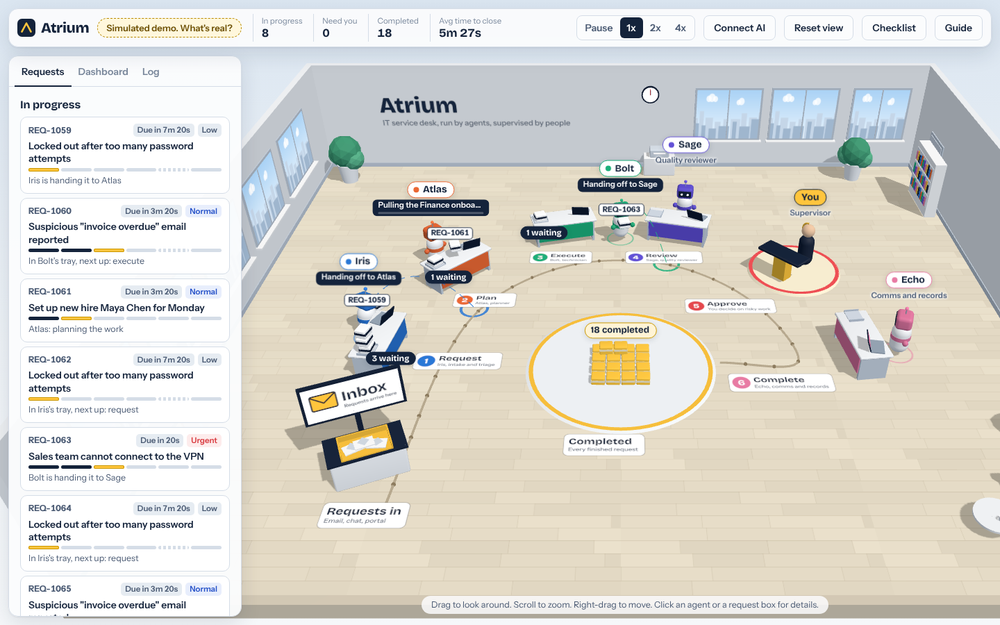
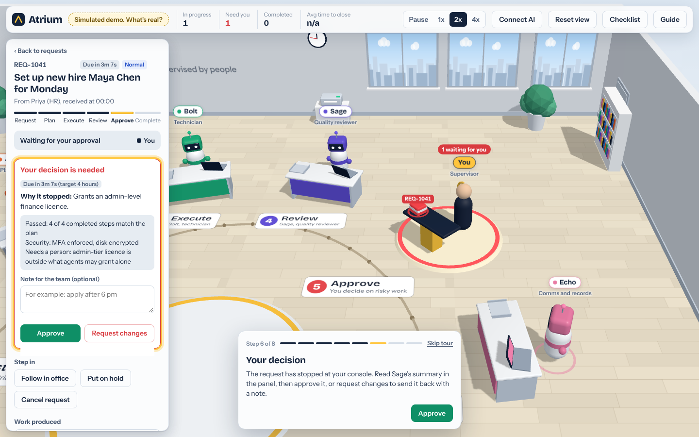
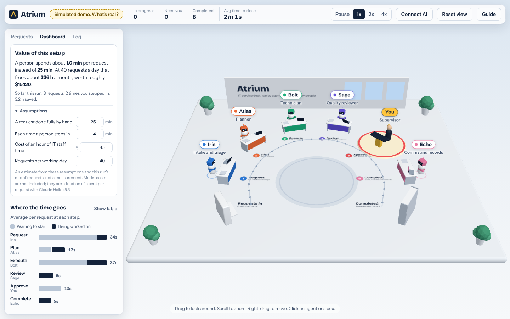
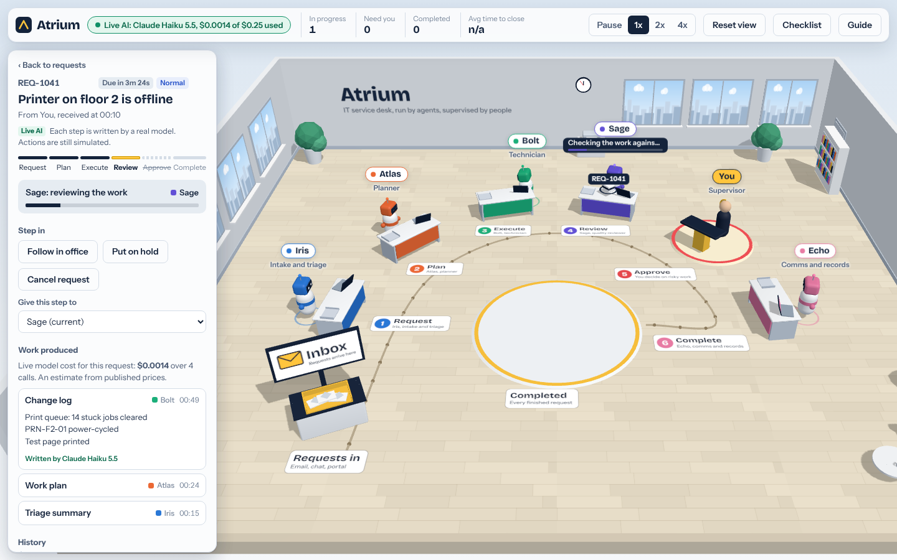
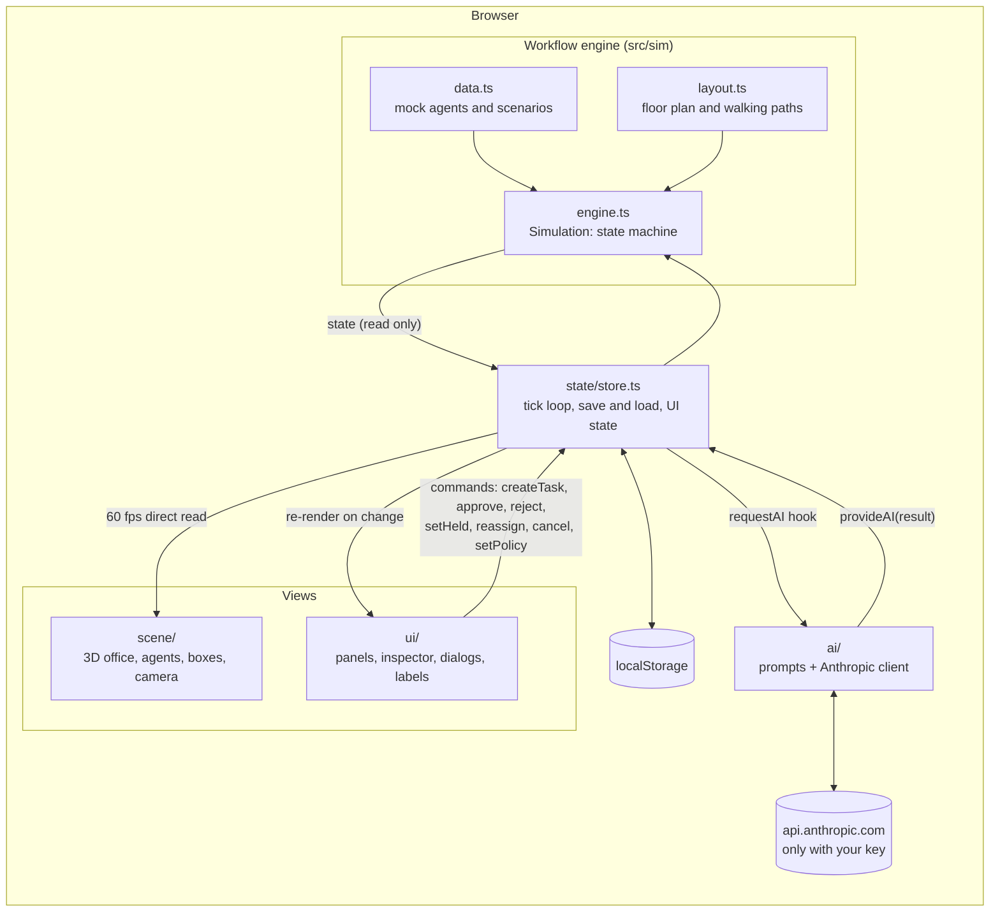
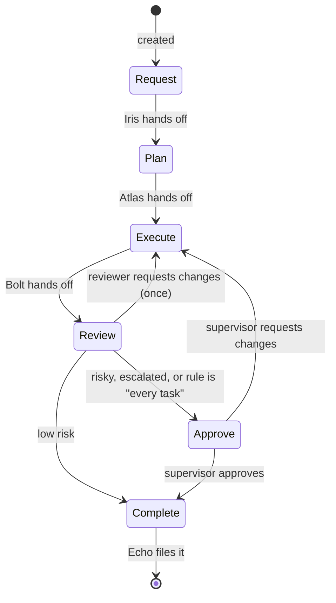
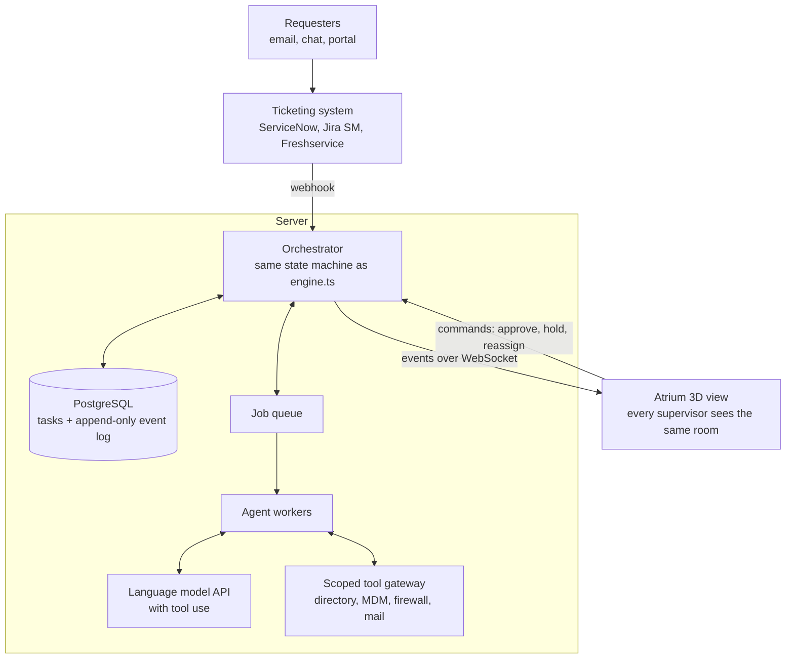

# Atrium: an AI virtual office for the IT service desk

A browser-based 3D office where five AI agents work an IT support queue as a team, and a human supervisor approves risky work and steps in when needed. You can watch each request get triaged, planned, executed, reviewed, approved and closed, and see exactly who owns it at every moment.

| | |
|---|---|
| **Live demo** | https://bgrandy.github.io/virtual-office/ |
| **Repository** | https://github.com/BGrandy/virtual-office |
| **Status** | Working demo. Agents are scripted by default, with an optional live mode where a real Claude model does each step using your own API key. No real IT system is touched in either mode. See [What is real](#what-is-real-simulated-and-proposed). |



**Highlights**

- **Guided tour.** Two minutes, one request from arrival to closed, with the camera moving to each agent as it works and a short note explaining each step.
- **Live AI mode (optional).** Paste a Claude API key and every agent's step becomes a real model call. Type any IT request and watch it get triaged, planned, executed, reviewed and answered. The workflow engine, not the model, decides who gets the work next.
- **Manager dashboard.** Where each request's time goes (waiting vs working, per step), which desk is the bottleneck right now, how often people had to step in, and a plain-language recommendation.
- **Human in charge.** Risky work stops for approval. The supervisor can approve, send back with a note, hold, reassign or cancel anything at any time.
- **Response-time targets.** Every request has a deadline set by its priority, a live countdown, and an alert before it is missed. Queues are worked earliest-deadline-first.
- **Business value and audit.** The dashboard turns the run into hours and cost saved using assumptions you can edit, and every request's full history downloads as JSON or CSV.
- **Runs on modest laptops.** On a weak or software-only graphics chip, or if motion gets choppy, it switches itself to a lighter mode.

## Contents

1. [The problem and the idea](#the-problem-and-the-idea)
2. [How a real team would use it](#how-a-real-team-would-use-it)
3. [User guide](#user-guide)
4. [Example walkthrough](#example-walkthrough)
5. [The dashboard](#the-dashboard)
6. [Live AI mode](#live-ai-mode)
7. [What is real, simulated and proposed](#what-is-real-simulated-and-proposed)
8. [Architecture](#architecture)
9. [Tech stack and why](#tech-stack-and-why)
10. [How this becomes a production system](#how-this-becomes-a-production-system)
11. [Key design decisions](#key-design-decisions)
12. [Run, test and deploy](#run-test-and-deploy)
13. [How the result was verified](#how-the-result-was-verified)
14. [Limitations](#limitations)
15. [How AI tools were used](#how-ai-tools-were-used)

## The problem and the idea

When several AI agents work together, the usual view is a chat transcript or a log. That makes three questions hard to answer quickly:

- **Who has this task right now?**
- **Where is work piling up?**
- **What is waiting on a person?**

Atrium answers them spatially. Each agent has a desk. A request is a physical box. Whoever is holding the box owns the task. A handoff is an agent walking the box to the next desk. A request that needs a human sits glowing on the supervisor's console until someone decides. A manager can glance at the room and read the state of the team without opening a single ticket.

I chose an IT service desk as the setting because it is the work this role does, and because support tickets already follow the pipeline the brief asks for: request, planning, execution, review, completion.

### The team

| Step | Owner | Role | What it does | Guardrail |
|---|---|---|---|---|
| 1. Request | **Iris** | Intake and triage | Classifies the request, sets priority, checks for duplicates | Cannot change any system |
| 2. Plan | **Atlas** | Planner | Turns the request into a short checkable plan, flags risky steps | Plans only |
| 3. Execute | **Bolt** | Technician | Carries out the plan and records what changed | Risky changes are staged, not applied |
| 4. Review | **Sage** | Quality reviewer | Checks the work against plan and policy, sends it back or escalates | Cannot edit what it reviews |
| 5. Approve | **You** | Supervisor | Approves or rejects risky work | Human only |
| 6. Complete | **Echo** | Comms and records | Replies to the requester, updates the knowledge base, closes the ticket | Only sends after review passes |

Separating the technician from the reviewer is deliberate. It is the same control a human team uses: the one who makes a change is not the one who signs it off.

## How a real team would use it

**Morning.** The IT lead opens Atrium on a second monitor. Overnight requests are already moving. Routine ones, such as account lockouts, have been closed by the agents without anyone touching them. The lead sees one box glowing on the supervisor console: a new-hire setup that includes an admin licence.

**Supervising.** The lead clicks the box, reads the reviewer's summary ("4 of 4 steps match the plan, MFA enforced, admin licence is outside what agents may grant alone") and approves it, optionally with a note. Echo picks it up and closes it out. If something looks wrong, the lead chooses "Request changes" instead, types what to fix, and the request goes back to the technician with that note attached.

**During an incident.** A VPN outage comes in as urgent, with a one-hour response target. It jumps the queue at every desk because agents always take the earliest deadline first. The agents diagnose it and stage a firewall fix with a rollback, but the fix does not go live until a person approves it. As the deadline gets close, the countdown turns amber and the dashboard tells the lead to decide on it now.

**Stepping in at any time.** On any open request the supervisor can:

- **Put it on hold.** Agents skip it until it is resumed. Useful while waiting on a user.
- **Give the current step to another agent.** Useful when one desk has a pile.
- **Cancel it.** The agent drops it immediately.
- **Change the approval rule** between "risky work only" and "every task". A new team starts cautious and loosens the rule as trust builds.

**Afterwards.** Every request keeps its full trail: who had it, when it changed hands, what each agent produced and what the human decided. That is the audit record.

**End of the week.** The lead opens the dashboard. It shows that most of each request's time is spent waiting for approval, not working, and that the technician's desk is where queues build. That turns into two concrete decisions: widen the approval rule for one low-risk request type, and add a second technician agent. The value panel, filled in with the team's own numbers, gives the hours and cost saved for the monthly report, and the request export goes to whoever audits changes.

The business case in one line: people stop doing the routine 80 percent and keep control of the risky 20 percent, with a view that makes the handover between the two obvious.

## User guide

| To do this | Do this |
|---|---|
| Look around | Drag to orbit, scroll to zoom, right-drag (or two-finger drag) to move. "Reset view" returns to the overview. |
| Learn it in two minutes | Welcome screen, "Take the tour". Reopen it any time from "Guide". |
| Start a request | Left panel, "Start a request". Pick one of four scenarios or type your own. |
| Load the office | "Simulate a busy morning" sends eight mixed requests at once. |
| See who an agent is | Click the agent or its name tag. The right panel shows its role, current work, tray, permitted systems and recent activity. |
| Follow a request | Click its box in the office or its row in the left panel. The right panel shows the pipeline, current owner, everything produced so far and the handoff trail. "Follow in office" makes the camera track the box. |
| Approve or reject | When a request stops for you, a red bar appears at the bottom and the box pulses on your console. Open it, read the review, then "Approve" or "Request changes". |
| Hold, reassign, cancel | Open the request, section "Step in". |
| Change the approval rule | Click "You" at the supervisor console. |
| See team performance | Left panel, "Dashboard". Open "Assumptions" in the value panel to enter your own numbers. |
| Check deadlines | Every request shows "Due in…", which turns amber when at risk and red when late. |
| Export a request's history | Open the request, "Audit record", then "Download JSON" or "Download CSV". All requests: Dashboard, "Download all requests (CSV)". |
| Change graphics quality | Top bar badge ("What's real?"), then Graphics: Auto, Full or Light. Or add `?quality=light` to the URL. |
| Read the full log | Left panel, "Log". Click any line to jump to that request. |
| Use a real model | Top bar, "Connect AI". See [Live AI mode](#live-ai-mode). |
| Control time | Top bar: Pause, 1x, 2x, 4x. |
| See what is simulated | Top bar, "Simulated demo" badge. |
| Start over | "Simulated demo" badge, then "Reset demo". |

Progress is saved in the browser, so a reload continues where you left off. The office keeps running in a background tab. On a phone, the panels open as sheets from the bottom so the office stays visible above them.

### The four scenarios

| Scenario | Shows |
|---|---|
| Set up new hire Maya Chen | The full path including the human approval gate |
| Sales team cannot connect to the VPN | Urgent priority jumping the queue, plus approval of a production change |
| Suspicious "invoice overdue" email | The reviewer finding a gap and sending work back (rework loop) |
| Locked out after too many password attempts | A routine request the agents finish without stopping for anyone |

## Example walkthrough

Choose **Take the tour** on the welcome screen. It sends the new-hire request and narrates each step as it happens. Each tour step waits for the real workflow event, so it never runs ahead of what is on screen.

1. **Request.** A box appears at the mail slot and hops to Iris's tray. Iris classifies it as onboarding, normal priority, due before Monday, then walks it to Atlas.
2. **Plan.** Atlas matches the Finance onboarding runbook, writes five steps and flags step 4 (admin-tier licence) as needing approval. Walks it to Bolt.
3. **Execute.** Bolt creates the account, adds groups, enrols the laptop and stages the licence without applying it. Walks it to Sage.
4. **Review.** Sage checks each step against the change log, confirms MFA and disk encryption, and decides a person must sign off the licence. Walks it to the supervisor console.
5. **Approve.** Everything stops. The box turns red on your console, the top bar shows "Need you: 1", and the approval card is highlighted. You approve, or request changes with a note.
6. **Complete.** The box moves to Echo, who writes the reply to HR, closes the ticket and files the box on the archive shelf.

At each step the right panel adds the agent's output and a line in "Who had it, and when". While an agent carries a request, a dashed arc shows where it is going: the carrier's colour for a normal handoff, gold when it is going to you, red when it is being sent back.



## The dashboard

Every figure is computed live from the run by `src/sim/metrics.ts`, which has its own unit tests.

| Section | What it answers |
|---|---|
| **What to act on** | One plain-language sentence, chosen by rules in this order: a request about to miss (or past) its response target, a pile-up at a desk right now, requests stuck waiting for you, or otherwise the step that takes the biggest share of each request's time. |
| **Tiles** | Completed, average time to close, share closed without any human action, share sent back for changes, share that met its response target. |
| **Value of this setup** | Human minutes per request with Atrium versus by hand, and the hours and cost that frees each month. Uses this run's real mix of requests and interventions, plus four assumptions you can edit. |
| **Where the time goes** | For each step, the average time a request waited before work started versus the time spent working. Hover for exact figures, or switch to a table. |
| **Right now** | Each agent's tray size and how busy it has been. |
| **Your oversight** | Approvals, send-backs, holds, reassignments and cancellations. |
| **Export** | Every request as one CSV row: times, priority, target met or missed, rework rounds, human actions. |

### Response-time targets

| Priority | Target in a real desk | In the simulation |
|---|---|---|
| Urgent (P1) | 1 hour | 60 seconds |
| Normal (P2) | 4 hours | 4 minutes |
| Low (P3) | 8 hours | 8 minutes |

The demo runs about 60 times faster than a real desk, so one simulated second stands for about one minute. A request is "at risk" in the last quarter of its target. Agents take the earliest deadline first, which puts urgent work ahead without letting old low-priority work wait forever. If a request passes its target while open, that is logged once as an event.

### Value estimate

Defaults: 25 minutes for a request done by hand, 4 minutes each time a person steps in, $45 an hour, 40 requests a day, 21 working days a month. All four can be changed in the app and are remembered in the browser. The figure is an estimate from those assumptions and the run, and the app says so next to it.

Try "Simulate a busy morning": the dashboard shows the queue build at Iris's desk first, then moves on to whichever desk is the bottleneck.



## Live AI mode

Off by default. Click **Connect AI**, paste an Anthropic API key, pick a model (Claude Haiku 5.5 is the default) and click "Test key and turn on". From then on, new requests are worked by the real model.

**What changes.** Each agent's step becomes one call to the Messages API with that agent's role, its limits and the work handed to it so far. The answer comes back through a forced tool call with a typed schema, so the engine gets fields such as `priority`, `risky` and `verdict` rather than free text to parse. Type anything ("Printer on floor 2 is offline", "Reset MFA for a contractor") and every agent's output will be about your request. Each output is labelled with the model that wrote it.

**What the model may decide, and what it may not.**

| The model can | The engine enforces |
|---|---|
| Set the priority at triage | Priority only reorders queues |
| Flag the plan as risky | Risky work always stops for a person |
| Pass, request changes or escalate at review | One round of changes at most, then it goes to a person instead of looping |
| Write every output | A malformed answer or failed call falls back to the scripted step, and the log says so |

A model can never skip review, approve its own work or change who owns a task. Those rules live in `engine.ts`, not in a prompt, and are covered by tests that use a fake model.

**What stays simulated.** No real system is connected. The prompt tells the model it has no system access and should describe what it would do, so change logs describe actions rather than perform them.

**The key.** It is sent only from your browser to `api.anthropic.com`, using the API's opt-in header for direct browser calls. There is no Atrium server. By default it is kept for the current tab only; "Remember on this device" is opt-in. One request makes five short calls, a fraction of a cent with Haiku.

**Honest scope.** I tested this path end to end against a mocked API that returns realistic tool calls. The request format, headers, model ID and response parsing are all checked, but a reviewer with a real key is the first live run.



## What is real, simulated and proposed

| Feature | Status | Notes |
|---|---|---|
| 3D office, camera, selection, follow mode | **Working** | Real-time scene, fully interactive |
| Workflow engine: ownership, queues, priority, handoffs, rework, approval gate | **Working** | Deterministic state machine with unit tests |
| Supervisor controls: approve, request changes, hold, resume, reassign, cancel, approval rule | **Working** | Each one changes the run |
| Activity log, per-request outputs and handoff trail | **Working** | Generated by the engine as events happen |
| Dashboard figures and recommendation | **Working** | Computed from the run, unit-tested |
| Response-time targets, countdowns and breach events | **Working** | Targets are compressed (see above) |
| Value estimate | **Working, estimate** | Calculated from the run and editable assumptions, not measured savings |
| Audit export (JSON, CSV) | **Working** | Times are simulated seconds |
| Adaptive graphics | **Working** | Auto, Full or Light |
| Guided tour | **Working** | Driven by real workflow events |
| Saved state across reloads | **Working** | Browser storage only |
| Live model-backed agents | **Optional, working** | Needs your own Claude API key. Off by default. Tested against a mocked API (see above) |
| Agent outputs without a key | **Simulated** | Scripted per scenario in `src/sim/data.ts`, labelled "Scripted" in the app |
| Typed custom requests without a key | **Simulated** | Generic placeholder output. The text is only understood in live AI mode |
| Stage durations | **Simulated** | Fixed timers (5 to 11 seconds per stage at 1x). In live mode, also the model's response time |
| IT systems (directory, firewall, mail, device management) | **Simulated** | Never connected, in either mode. Names like FW-2291 are invented |
| Real tool access through a permission gateway | **Proposed** | See [production design](#how-this-becomes-a-production-system) |
| Server-side orchestration, shared multi-user view | **Proposed** | |
| Durable database, ticketing integration, SLA notifications by email or chat | **Proposed** | |

The same table is in the app (top bar badge, then "What's real?"). Every agent profile notes that its tool access is simulated, and every output says whether a script or a model wrote it.

## Architecture

The central decision is that **the workflow engine knows nothing about the screen**. It is a plain TypeScript class with no React, three.js or browser dependency. The UI reads its state and sends it commands, and nothing else.



### Component responsibilities

| Path | Responsibility |
|---|---|
| `src/sim/types.ts` | The data model: `Task`, `AgentState`, `Handoff`, `Output`, `StageSpan`, `AIStageResult`, `SimEvent`, `SimState`. Everything is plain JSON. |
| `src/sim/engine.ts` | The orchestrator. Advances time, lets each agent pick up, work on and hand off tasks, applies supervisor commands, enforces the rules a model may not override, records stage timings, steers walking agents around each other, writes the event log. |
| `src/sim/data.ts` | Agent profiles and the scripted steps and outputs for each scenario. |
| `src/sim/metrics.ts` | Dashboard figures, the recommendation sentence and the value estimate, computed from engine state. |
| `src/sim/sla.ts` | Response-time state for a request: on track, at risk, breached, met or missed. |
| `src/sim/audit.ts` | Builds the JSON and CSV exports, with CSV quoting that guards against spreadsheet formula injection. |
| `src/sim/layout.ts` | Station positions and the points agents walk between. |
| `src/ai/prompts.ts` | Builds one agent's request for one step: role, limits, the work so far, and a typed tool schema. |
| `src/ai/anthropic.ts` | Calls the Messages API from the browser, validates the answer, and turns failures into a clear error so the engine can fall back. |
| `src/state/store.ts` | Owns the engine instance, runs the tick loop (including in a background tab), dispatches live AI calls, saves to browser storage, holds UI-only state (selection, camera focus, tour, dialogs, AI settings). |
| `src/scene/` | The 3D view, loaded as a separate chunk. Reads engine state every frame. Contains no workflow rules. `Quality.tsx` picks the graphics level. |
| `src/ui/` | Panels, dashboard, tour, inspector, dialogs and the labels that float over the scene. |
| `*.test.ts` | 40 unit tests across the engine, the live AI rules, prompt building, response parsing, response-time targets, the dashboard figures, the value estimate and the exports. |

### Task flow



Within each stage a task is `queued` (in the owner's tray), `active` (being worked on) or `handoff` (being carried). Ownership changes only when the carrier arrives, so a task always has exactly one owner. Agents take the earliest response-time deadline first and skip anything on hold. Each visit to a step is recorded as a span (arrived, started, finished), which is what the dashboard measures.

In live AI mode the engine asks for a model result when an agent starts a step, holds the progress bar at 80% until it arrives, then plays the model's own step descriptions in the speech bubble.

### State updates

- The engine mutates one state object and sets a `dirty` flag when something discrete happens.
- The 3D scene reads positions straight from that object on every animation frame, so movement is smooth without React re-rendering 60 times a second.
- Panels re-render when `dirty` is set, and at most five times a second otherwise for progress bars.
- State is written to localStorage every two seconds and after every command.
- Browsers pause animation frames in background tabs, so a one-second timer keeps the simulation running there.

## Tech stack and why

| Choice | Why |
|---|---|
| **TypeScript** | The workflow is a state machine with many small states. Types catch illegal transitions at compile time. |
| **React 19** | Standard, well understood, good for the panel-heavy half of the interface. |
| **three.js with React Three Fiber** | Lets the 3D scene be written as components beside the rest of the UI. No game engine or plugin to install. |
| **Zustand** | A few lines for UI state. Redux would be more ceremony than this needs. |
| **Vite** | Fast dev server and a static build that any free host can serve. |
| **Vitest** | Runs the engine tests in under a second with no browser. |
| **GitHub Pages and Actions** | Free hosting. The included workflow runs the tests, builds and deploys on every push. |
| **No backend** | The brief allows mock data. A static site has nothing to go down during a review, and costs nothing. |
| **No 3D model files** | Everything is built from primitive shapes in code, so the page loads fast and there are no asset licences to track. |
| **Code splitting** | three.js is loaded as a separate chunk, so the panels and welcome screen appear after about 95 KB (compressed) instead of 340 KB. |
| **Anthropic Messages API, called from the browser** | Lets the live mode work on a static site with no server and no shared key. The user's key never leaves their browser except to the API. |

## How this becomes a production system

Because the UI only reads state and sends commands, the engine can move to a server without rewriting the views.



**Agent orchestration.** The orchestrator keeps the same rules as `engine.ts`: one owner per task, a fixed set of allowed transitions, priority queues and an approval gate. When a task becomes `active`, it enqueues a job instead of starting a timer. The orchestrator stays deterministic. Only the work inside a stage is done by a model, so a model can never skip review or approve its own work.

**Real AI integration.** Live AI mode already shows the shape of this. Each agent is one model call with a role-specific system prompt, the task so far as context, and a typed output schema (`src/ai/prompts.ts`). In production that call moves into a server-side worker, the key moves into a secrets store, and each agent gets real tools for its role only: Iris reads tickets, Bolt writes to the identity provider through a gateway that stages risky calls. The reviewer should run on separate instructions from the technician, and ideally a different model, so it does not share the same blind spots.

**State updates.** The server broadcasts the same event types the demo already logs (`started`, `step`, `handoff`, `approval-requested` and so on) over WebSocket or server-sent events. The view applies them to its local copy of the state. Walking animations are computed in the browser from handoff events and do not need to be sent.

**Persistence.** PostgreSQL holds current task state and an append-only event table. The event table is the audit trail and allows any request to be replayed. The demo's `SimState` is already serialisable, and one of the tests saves and restores it mid-handoff.

**Safety and supervision.** Tool permissions per role are enforced at the gateway, not in prompts. Risk rules decide what needs approval. Approvals record who and when through single sign-on. Timeouts and retry limits stop a stuck agent. The demo already enforces two of these in the engine: a review can send work back only once before it escalates to a person, and a failed model call falls back instead of stalling.

**Rollout.** Start in shadow mode, where agents draft and people do the work, then turn on autonomy one request type at a time, lowest risk first. The approval rule switch in the demo is the small version of that control.

## Key design decisions

- **Ownership is physical.** A task has one location and so one owner. This removes the most common confusion in multi-agent views.
- **The human is drawn as a person, on a raised platform, in a different colour.** The approval step should look different from the automated steps because it is different.
- **The room is a horseshoe in workflow order.** Work moves left to right around it, so position tells you progress. Floor numbers match the pipeline in the side panel.
- **Three ways to read the same state.** The room for a glance, the request list for the queue, the inspector for detail. All three are driven by the same engine state, so they cannot disagree.
- **Blocked on a human is the loudest thing on screen.** Red is used only for that and for rework.
- **Disclosure is built in.** A permanent badge in the top bar and a note on each agent, not just a line in this file.
- **Scenarios were chosen to cover the paths.** Straight through, approval gate, rework loop and priority, so a reviewer can see each behaviour in about a minute.
- **Colours were checked, not picked by eye.** Each agent has one colour, used on its robot, desk, floor marker and name tag. The five were chosen and ordered with a colour-blindness validator so that neighbouring desks stay distinguishable for common colour vision deficiencies. Agents are always named as well, so colour is never the only cue. Request boxes are neutral so they never borrow an agent's colour. Gold means you, red means it needs you.
- **The model proposes, the engine decides.** Live AI changes who writes the work, not who controls the workflow. That boundary is the main thing I would keep in production.
- **The tour follows the simulation.** Each step waits for a real event instead of a timer, so it cannot drift out of sync, and it still works if you send the request back instead of approving it.
- **Earliest deadline first, not strict priority.** Strict priority can leave low-priority work waiting forever on a busy day. Ordering by deadline still puts urgent work first, because its deadline is shortest.
- **It degrades instead of stuttering.** A reviewer may open the link on a work laptop with basic graphics. The app checks the graphics chip and the frame rate, and drops shadows and resolution rather than playing choppily. The viewer can override it.
- **Value is shown with its assumptions.** The saving figure sits next to the inputs that produced it, labelled as an estimate, so it can be challenged and adjusted rather than taken on faith.
- **The dashboard says what to do, not only what happened.** A rule-based sentence names the bottleneck and the action, because a manager glancing at charts wants the conclusion first.

## Run, test and deploy

Requires Node 20 or newer.

```bash
npm install
npm run dev        # http://localhost:5173
npm test           # 40 unit tests
npm run build      # type-check and build to dist/
npm run preview    # serve the production build locally
```

`npm run build -- --mode single` writes one self-contained HTML file to `dist-single/`, which is handy as an offline copy.

### Deploy

**GitHub Pages (workflow included).**

1. Create a repository on GitHub and push this project to the `main` branch.
2. In the repository, open Settings, Pages, and set Source to "GitHub Actions".
3. The workflow in `.github/workflows/deploy.yml` runs the tests, builds, and publishes. The URL appears on the Actions run and under Settings, Pages.

The build uses relative paths, so it also works unchanged on Netlify, Vercel or Cloudflare Pages (build command `npm run build`, output folder `dist`).

## How the result was verified

- **Unit tests** (`npm test`, 40 tests):
  - *Workflow:* a request running end to end, the approval gate, supervisor rejection with the note attached, the rework loop, the "every task" rule, hold and resume, reassignment, priority ordering, cancel, and save and restore mid-handoff.
  - *Busy office:* eight mixed requests clearing with agents crossing paths, no deadlock, and everyone back at their desk.
  - *Live AI rules (with a fake model):* outputs are used and labelled, priority and risk flags are applied, the one-rework limit escalates, a model "pass" cannot skip the approval gate on risky work, and failures fall back to the script.
  - *AI layer:* prompts contain only the right role and context, and malformed or out-of-range answers are rejected or ignored.
  - *Dashboard:* autonomy share, the waiting/working split, and that the recommendation names a pile-up and slow approvals.
  - *Response targets:* on track to at risk to breached, a single breach event, met and missed on completion, earliest-deadline-first ordering, and the recommendation putting an at-risk request first.
  - *Value and export:* the value arithmetic, no negative savings, the full audit trail, and CSV quoting including formula-like text.
- **Type checking** runs with TypeScript strict mode as part of every build.
- **Browser checks** in headless Chrome at 1440×900, 1280×720 and a 390×844 phone: the full tour including the approval step, a busy morning through to the dashboard, chart tooltip and table view, and live AI mode against a mocked Claude API (checking the request headers, model ID, all five stage calls, output labels, and that the key stays in tab-only storage). Also: light graphics switching on by itself on a software renderer, the at-risk recommendation during a busy morning, the value figures updating when an assumption changes, and all three downloads opened and checked. Screenshots were inspected and the console checked for errors.
- **CI** repeats the tests and build on every push before deploying.

## Limitations

- Without an API key, agents are scripted, and typed requests get generic output.
- Live AI mode has been tested against a mocked API, not a real key. Model answers vary, so live runs are less predictable than the scripted ones, which is why scripted is the default for a demo.
- Your API key sits in the browser while live mode is on. Fine for a demo with your own key; a production version would keep keys on a server.
- No real IT systems or tools are connected in either mode.
- One browser, one user. There is no server, login or shared view.
- State lives in browser storage. Clearing site data resets the demo.
- Dashboard times and response targets are simulated seconds, compressed about 60 times from a real desk.
- The value figure is an estimate from assumptions, not measured savings.
- Needs WebGL. Without it the panels still work but the 3D office does not appear.
- Agents steer around each other, but in a very crowded moment two can briefly overlap.
- No screen-reader description of the 3D scene itself. The same information is available in the panels, which use standard buttons, lists and tables.

## How AI tools were used

The brief encourages AI tools and asks for transparency about them.

- **Claude (Anthropic), working as a coding agent,** wrote the source code, the unit tests, the deployment workflow and this README from the assessment brief. It also ran the automated checks listed above, including the headless-browser screenshots.
- **My role** was to set the direction and own the result: I supplied the brief and the quality bar (a carefully planned, visually polished, smooth-running demo), chose which improvements to build after the first version (the guided tour, live AI mode, the dashboard, and the visual and mobile polish), directed the work, reviewed the output, and tested the deployed demo in my own browser before submitting.

## Project structure

```
src/
  sim/        workflow engine, mock data, dashboard metrics, floor plan, tests (no UI code)
  ai/         prompt building and the Anthropic client, tests
  state/      engine instance, tick loop, persistence, UI state
  scene/      3D office, agents, task boxes, handoff arcs, camera
  ui/         panels, dashboard, tour, inspector, dialogs, floating labels
docs/         screenshots used in this README
.github/      test, build and deploy workflow
```
