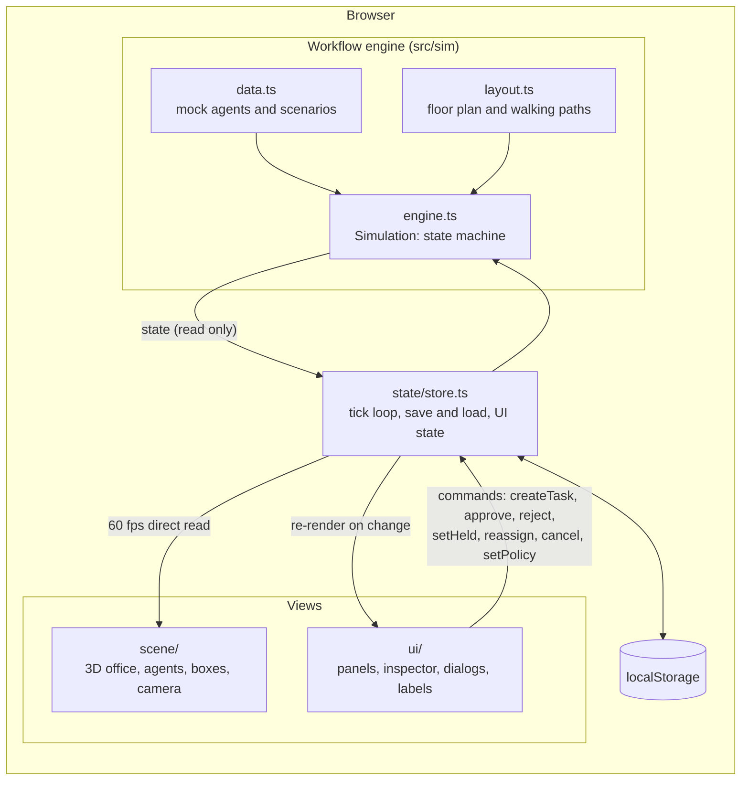
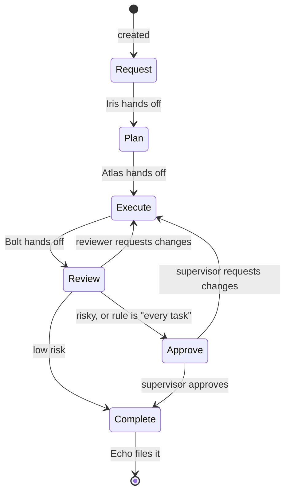
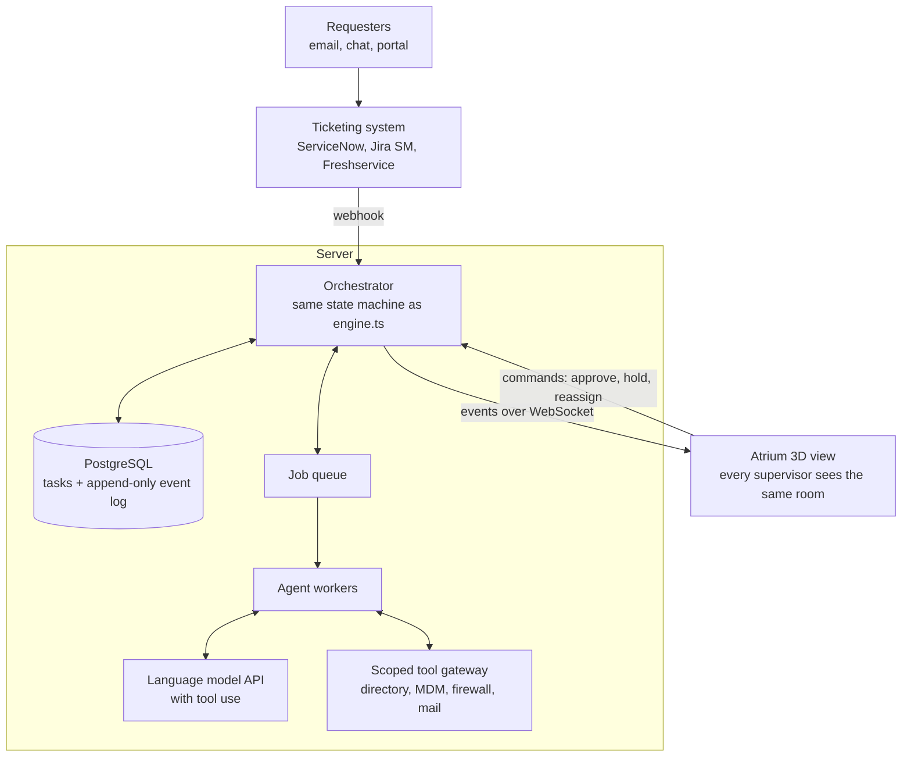

# Atrium: an AI virtual office for the IT service desk

A browser-based 3D office where five AI agents work an IT support queue as a team, and a human supervisor approves risky work and steps in when needed. You can watch each request get triaged, planned, executed, reviewed, approved and closed, and see exactly who owns it at every moment.

| | |
|---|---|
| **Live demo** | https://bgrandy.github.io/virtual-office/ |
| **Repository** | https://github.com/BGrandy/virtual-office |
| **Status** | Working demo with simulated agents. No AI model or real IT system is called. See [What is real](#what-is-real-simulated-and-proposed). |


## Contents

1. [The problem and the idea](#the-problem-and-the-idea)
2. [How a real team would use it](#how-a-real-team-would-use-it)
3. [User guide](#user-guide)
4. [Example walkthrough](#example-walkthrough)
5. [What is real, simulated and proposed](#what-is-real-simulated-and-proposed)
6. [Architecture](#architecture)
7. [Tech stack and why](#tech-stack-and-why)
8. [How this becomes a production system](#how-this-becomes-a-production-system)
9. [Key design decisions](#key-design-decisions)
10. [Run, test and deploy](#run-test-and-deploy)
11. [How the result was verified](#how-the-result-was-verified)
12. [Limitations](#limitations)
13. [How AI tools were used](#how-ai-tools-were-used)

## The problem and the idea

When several AI agents work together, the usual view is a chat transcript or a log. That makes three questions hard to answer quickly:

- **Who has this task right now?**
- **Where is work piling up?**
- **What is waiting on a person?**

Atrium answers them spatially. Each agent has a desk. A request is a physical box. Whoever is holding the box owns the task. A handoff is an agent walking the box to the next desk. A request that needs a human sits glowing on the supervisor's console until someone decides. A manager can glance at the room and read the state of the team without opening a single ticket.

I chose an IT service desk as the setting because it is the work this role does, and because support tickets already follow the pipeline the brief asks for: request, planning, execution, review, completion.

### The team

| Step | Owner | Role | What it does | Guardrail |
|---|---|---|---|---|
| 1. Request | **Iris** | Intake and triage | Classifies the request, sets priority, checks for duplicates | Cannot change any system |
| 2. Plan | **Atlas** | Planner | Turns the request into a short checkable plan, flags risky steps | Plans only |
| 3. Execute | **Bolt** | Technician | Carries out the plan and records what changed | Risky changes are staged, not applied |
| 4. Review | **Sage** | Quality reviewer | Checks the work against plan and policy, sends it back or escalates | Cannot edit what it reviews |
| 5. Approve | **You** | Supervisor | Approves or rejects risky work | Human only |
| 6. Complete | **Echo** | Comms and records | Replies to the requester, updates the knowledge base, closes the ticket | Only sends after review passes |

Separating the technician from the reviewer is deliberate. It is the same control a human team uses: the one who makes a change is not the one who signs it off.

## How a real team would use it

**Morning.** The IT lead opens Atrium on a second monitor. Overnight requests are already moving. Routine ones, such as account lockouts, have been closed by the agents without anyone touching them. The lead sees one box glowing on the supervisor console: a new-hire setup that includes an admin licence.

**Supervising.** The lead clicks the box, reads the reviewer's summary ("4 of 4 steps match the plan, MFA enforced, admin licence is outside what agents may grant alone") and approves it, optionally with a note. Echo picks it up and closes it out. If something looks wrong, the lead chooses "Request changes" instead, types what to fix, and the request goes back to the technician with that note attached.

**During an incident.** A VPN outage comes in as urgent. It jumps the queue at every desk. The agents diagnose it and stage a firewall fix with a rollback, but the fix does not go live until a person approves it.

**Stepping in at any time.** On any open request the supervisor can:

- **Put it on hold.** Agents skip it until it is resumed. Useful while waiting on a user.
- **Give the current step to another agent.** Useful when one desk has a pile.
- **Cancel it.** The agent drops it immediately.
- **Change the approval rule** between "risky work only" and "every task". A new team starts cautious and loosens the rule as trust builds.

**Afterwards.** Every request keeps its full trail: who had it, when it changed hands, what each agent produced and what the human decided. That is the audit record.

The business case in one line: people stop doing the routine 80 percent and keep control of the risky 20 percent, with a view that makes the handover between the two obvious.

## User guide

| To do this | Do this |
|---|---|
| Look around | Drag to orbit, scroll to zoom, right-drag (or two-finger drag) to move. "Reset view" returns to the overview. |
| Start a request | Left panel, "Start a request". Pick one of four scenarios or type your own. |
| See who an agent is | Click the agent or its name tag. The right panel shows its role, current work, tray, permitted systems and recent activity. |
| Follow a request | Click its box in the office or its row in the left panel. The right panel shows the pipeline, current owner, everything produced so far and the handoff trail. "Follow in office" makes the camera track the box. |
| Approve or reject | When a request stops for you, a red bar appears at the bottom and the box pulses on your console. Open it, read the review, then "Approve" or "Request changes". |
| Hold, reassign, cancel | Open the request, section "Step in". |
| Change the approval rule | Click "You" at the supervisor console. |
| Read the full log | Left panel, "Activity log". Click any line to jump to that request. |
| Control time | Top bar: Pause, 1x, 2x, 4x. |
| See what is simulated | Top bar, "Simulated demo" badge. |
| Start over | "Simulated demo" badge, then "Reset demo". |

Progress is saved in the browser, so a reload continues where you left off.

### The four scenarios

| Scenario | Shows |
|---|---|
| Set up new hire Maya Chen | The full path including the human approval gate |
| Sales team cannot connect to the VPN | Urgent priority jumping the queue, plus approval of a production change |
| Suspicious "invoice overdue" email | The reviewer finding a gap and sending work back (rework loop) |
| Locked out after too many password attempts | A routine request the agents finish without stopping for anyone |

## Example walkthrough

Choose **Run the guided example** on the welcome screen. It starts the new-hire scenario.

1. **Request.** A box appears at the mail slot and hops to Iris's tray. Iris classifies it as onboarding, normal priority, due before Monday, then walks it to Atlas.
2. **Plan.** Atlas matches the Finance onboarding runbook, writes five steps and flags step 4 (admin-tier licence) as needing approval. Walks it to Bolt.
3. **Execute.** Bolt creates the account, adds groups, enrols the laptop and stages the licence without applying it. Walks it to Sage.
4. **Review.** Sage checks each step against the change log, confirms MFA and disk encryption, and decides a person must sign off the licence. Walks it to the supervisor console.
5. **Approve.** Everything stops. The box pulses, the top bar shows "Need you: 1", and a bar at the bottom offers "Review REQ-1041". You approve.
6. **Complete.** The box moves to Echo, who writes the reply to HR, closes the ticket and files the box on the archive shelf.

At each step the right panel adds the agent's output and a line in "Who had it, and when".


## What is real, simulated and proposed

| Feature | Status | Notes |
|---|---|---|
| 3D office, camera, selection, follow mode | **Working** | Real-time scene, fully interactive |
| Workflow engine: ownership, queues, priority, handoffs, rework, approval gate | **Working** | Deterministic state machine with unit tests |
| Supervisor controls: approve, request changes, hold, resume, reassign, cancel, approval rule | **Working** | Each one changes the run |
| Activity log, per-request outputs and handoff trail | **Working** | Generated by the engine as events happen |
| Saved state across reloads | **Working** | Browser localStorage only |
| Agent reasoning, steps and written outputs | **Simulated** | Scripted per scenario in `src/sim/data.ts`. No language model is called |
| Stage durations | **Simulated** | Fixed timers (5 to 11 seconds per stage at 1x) |
| IT systems (directory, firewall, mail, device management) | **Simulated** | Nothing is connected. Names like FW-2291 are invented |
| Typed custom requests | **Simulated** | Run through a generic placeholder script. The text is not interpreted |
| Model-backed agents with tool use | **Proposed** | See [production design](#how-this-becomes-a-production-system) |
| Server-side orchestration, shared multi-user view | **Proposed** | |
| Durable database, audit export, SLA alerts, ticketing integration | **Proposed** | |

The same table is available inside the app from the "Simulated demo" badge, and every agent profile carries a note that its tool access is simulated.

## Architecture

The central decision is that **the workflow engine knows nothing about the screen**. It is a plain TypeScript class with no React, three.js or browser dependency. The UI reads its state and sends it commands, and nothing else.



### Component responsibilities

| Path | Responsibility |
|---|---|
| `src/sim/types.ts` | The data model: `Task`, `AgentState`, `Handoff`, `Output`, `SimEvent`, `SimState`. Everything is plain JSON. |
| `src/sim/engine.ts` | The orchestrator. Advances time, lets each agent pick up, work on and hand off tasks, applies supervisor commands, writes the event log. |
| `src/sim/data.ts` | All mock content: agent profiles and the scripted steps and outputs for each scenario. This is the file a real model integration replaces. |
| `src/sim/layout.ts` | Station positions and the points agents walk between. |
| `src/sim/engine.test.ts` | Unit tests for the engine. |
| `src/state/store.ts` | Owns the single engine instance, runs the tick loop, saves to localStorage, holds UI-only state (selection, follow, dialogs). |
| `src/scene/` | The 3D view. Reads engine state every frame. Contains no workflow rules. |
| `src/ui/` | Panels, inspector, dialogs and the labels that float over the scene. |

### Task flow



Within each stage a task is `queued` (in the owner's tray), `active` (being worked on) or `handoff` (being carried). Ownership changes only when the carrier arrives, so a task always has exactly one owner. Agents take urgent work first, then oldest first, and skip anything on hold.

### State updates

- The engine mutates one state object and sets a `dirty` flag when something discrete happens.
- The 3D scene reads positions straight from that object on every animation frame, so movement is smooth without React re-rendering 60 times a second.
- Panels re-render when `dirty` is set, and at most five times a second otherwise for progress bars.
- State is written to localStorage every two seconds and after every command.

## Tech stack and why

| Choice | Why |
|---|---|
| **TypeScript** | The workflow is a state machine with many small states. Types catch illegal transitions at compile time. |
| **React 19** | Standard, well understood, good for the panel-heavy half of the interface. |
| **three.js with React Three Fiber** | Lets the 3D scene be written as components beside the rest of the UI. No game engine or plugin to install. |
| **Zustand** | A few lines for UI state. Redux would be more ceremony than this needs. |
| **Vite** | Fast dev server and a static build that any free host can serve. |
| **Vitest** | Runs the engine tests in under a second with no browser. |
| **GitHub Pages and Actions** | Free hosting. The included workflow runs the tests, builds and deploys on every push. |
| **No backend** | The brief allows mock data. A static site has nothing to go down during a review, and costs nothing. |
| **No 3D model files** | Everything is built from primitive shapes in code, so the page loads fast and there are no asset licences to track. |

## How this becomes a production system

Because the UI only reads state and sends commands, the engine can move to a server without rewriting the views.



**Agent orchestration.** The orchestrator keeps the same rules as `engine.ts`: one owner per task, a fixed set of allowed transitions, priority queues and an approval gate. When a task becomes `active`, it enqueues a job instead of starting a timer. The orchestrator stays deterministic. Only the work inside a stage is done by a model, so a model can never skip review or approve its own work.

**Real AI integration.** Each agent becomes a worker that calls a language model with a role-specific system prompt, the task so far (previous outputs are the context), and only the tools that role is allowed. Iris gets read access to tickets. Bolt gets write access to the identity provider but through a gateway that stages risky calls. The `StageScript` shape in `data.ts` (`steps` plus an `output`) is the contract: workers stream step updates and return a structured output. The reviewer should run on separate instructions from the technician, and ideally a different model, so it does not share the same blind spots.

**State updates.** The server broadcasts the same event types the demo already logs (`started`, `step`, `handoff`, `approval-requested` and so on) over WebSocket or server-sent events. The view applies them to its local copy of the state. Walking animations are computed in the browser from handoff events and do not need to be sent.

**Persistence.** PostgreSQL holds current task state and an append-only event table. The event table is the audit trail and allows any request to be replayed. The demo's `SimState` is already serialisable, and one of the tests saves and restores it mid-handoff.

**Safety and supervision.** Tool permissions per role are enforced at the gateway, not in prompts. Risk rules decide what needs approval. Approvals record who and when through single sign-on. Timeouts and retry limits stop a stuck agent, and a failed stage escalates to a person instead of looping.

**Rollout.** Start in shadow mode, where agents draft and people do the work, then turn on autonomy one request type at a time, lowest risk first. The approval rule switch in the demo is the small version of that control.

## Key design decisions

- **Ownership is physical.** A task has one location and so one owner. This removes the most common confusion in multi-agent views.
- **The human is drawn as a person, on a raised platform, in a different colour.** The approval step should look different from the automated steps because it is different.
- **The room is a horseshoe in workflow order.** Work moves left to right around it, so position tells you progress. Floor numbers match the pipeline in the side panel.
- **Three ways to read the same state.** The room for a glance, the request list for the queue, the inspector for detail. All three are driven by the same engine state, so they cannot disagree.
- **Blocked on a human is the loudest thing on screen.** Red is used only for that and for rework.
- **Disclosure is built in.** A permanent badge in the top bar and a note on each agent, not just a line in this file.
- **Scenarios were chosen to cover the paths.** Straight through, approval gate, rework loop and priority, so a reviewer can see each behaviour in about a minute.
- **Light theme with five strong colours.** Each agent's colour is used on its robot, desk, floor marker and name tag, and nowhere else.

## Run, test and deploy

Requires Node 20 or newer.

```bash
npm install
npm run dev        # http://localhost:5173
npm test           # engine unit tests
npm run build      # type-check and build to dist/
npm run preview    # serve the production build locally
```

`npm run build -- --mode single` writes one self-contained HTML file to `dist-single/`, which is handy as an offline copy.

### Deploy

**GitHub Pages (workflow included).**

1. Create a repository on GitHub and push this project to the `main` branch.
2. In the repository, open Settings, Pages, and set Source to "GitHub Actions".
3. The workflow in `.github/workflows/deploy.yml` runs the tests, builds, and publishes. The URL appears on the Actions run and under Settings, Pages.

The build uses relative paths, so it also works unchanged on Netlify, Vercel or Cloudflare Pages (build command `npm run build`, output folder `dist`).

## How the result was verified

- **Unit tests** (`npm test`) cover the engine: a low-risk request running end to end, the approval gate blocking until approved, supervisor rejection returning work to the technician with the note attached, the scripted rework loop, the "every task" rule, hold and resume, reassignment, urgent work jumping the queue, cancel, and save and restore in the middle of a handoff.
- **Type checking** runs with TypeScript strict mode as part of every build.
- **Browser checks** in headless Chrome: each scenario was run to completion, and the welcome dialog, approval flow, rework flow, activity log, follow mode and a phone-sized viewport were inspected from screenshots with the console checked for errors.
- **CI** repeats the tests and build on every push before deploying.

## Limitations

- Agents are scripted. Outputs do not change with the request text, and typed custom requests get generic output.
- One browser, one user. There is no server, login or shared view.
- State lives in localStorage. Clearing site data resets the demo.
- Desktop first. It runs on a phone, but the panels cover much of the scene.
- Needs WebGL. Without it the panels still work but the 3D office does not appear.
- Agents walk straight lines between fixed points and can pass through each other when several hand off at once.
- No screen-reader description of the 3D scene itself. The same information is available in the panels, which use standard buttons and lists.
- The simulation pauses while the browser tab is in the background.

## How AI tools were used

The brief encourages AI tools and asks for transparency about them.

- **Claude (Anthropic), working as a coding agent,** wrote the source code, the unit tests, the deployment workflow and this README from the assessment brief. It also ran the automated checks listed above, including the headless-browser screenshots.
- **My role** was to set the direction and own the result: I supplied the brief and the quality bar (a carefully planned, visually polished, smooth-running demo), directed the work, reviewed the output, and tested the deployed demo in my own browser before submitting.

## Project structure

```
src/
  sim/        workflow engine, mock data, floor plan, tests (no UI code)
  state/      engine instance, tick loop, persistence, UI state
  scene/      3D office, agents, task boxes, camera
  ui/         panels, inspector, dialogs, floating labels
docs/         screenshots used in this README
.github/      test, build and deploy workflow
```
